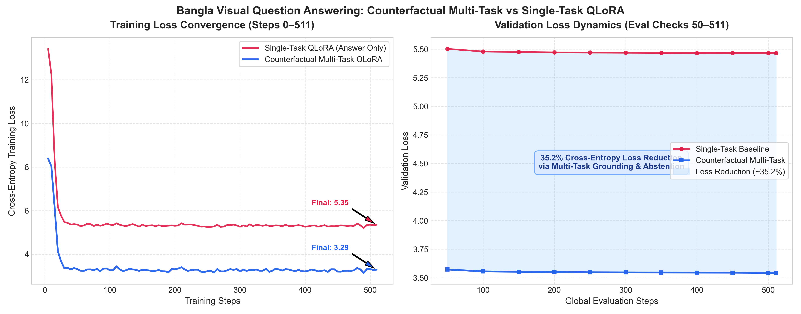

# Bangla-VQA-Multitask: Hallucination-Resistant Bangla Visual Question Answering via Counterfactual Multi-Task Instruction Tuning

[](https://www.python.org/downloads/)
[](https://pytorch.org/)
[](https://huggingface.co/docs/transformers)
[](https://github.com/huggingface/peft)
[](https://huggingface.co/Qwen/Qwen2-VL-2B-Instruct)
[-green.svg)](https://www.kaggle.com/)
[](LICENSE)

---

## 📌 Overview

Vision-Language Models (VLMs) applied to low-resource languages such as Bengali suffer from pronounced **hallucination rates**—frequently confabulating answers when presented with misleading, non-existent, or counterfactual visual queries.

**Bangla-VQA-Multitask** introduces an end-to-end framework combining:
1. **Counterfactual Multi-Task Instruction Tuning**: Rather than directly predicting an answer, the model is trained on a structured three-fold task:
   - **Relevance Discrimination (`প্রাসঙ্গিকতা`)**: Distinguish whether the question is answerable (`হ্যাঁ`) or counterfactual/unanswerable (`না`).
   - **Visual Evidence Grounding (`ভিজ্যুয়াল প্রমাণ`)**: Localize and describe the Bengali visual evidence in the image.
   - **Grounded Final Answer (`চূড়ান্ত উত্তর`)**: Provide the definitive answer or abstain gracefully.
2. **Parameter-Efficient 4-bit QLoRA**: Adapts only **0.829% (18.46M)** of `Qwen/Qwen2-VL-2B-Instruct`'s 2.23B parameters, running comfortably on Kaggle Dual-T4 GPUs within **11.69 GB VRAM**.
3. **Visual Contrastive Decoding (VCD)**: Mitigates visual object priors at inference time by contrasting logits from the original image against a Gaussian-blurred/distorted counterpart.

---

## 📊 Experimental Results: Multi-Task vs. Single-Task QLoRA

Both the Single-Task baseline (direct answer prediction) and Counterfactual Multi-Task QLoRA were trained for 511 steps (1 full epoch) on 10,008 samples from the Bengali VQA benchmark under identical hyperparameters.

### Head-to-Head Comparison Table

| Metric / Dimension | Single-Task Baseline (`singletask_qlora_full`) | Counterfactual Multi-Task (`multitask_qlora`) | Improvement / Relative Delta |
| :--- | :---: | :---: | :---: |
| **Base VLM** | `Qwen/Qwen2-VL-2B-Instruct` | `Qwen/Qwen2-VL-2B-Instruct` | Standardized |
| **Quantization Scheme** | 4-bit NF4 (`bitsandbytes`) | 4-bit NF4 (`bitsandbytes`) | Standardized |
| **LoRA Rank ($r$) & Alpha ($\alpha$)** | $r=16, \alpha=32$ | $r=16, \alpha=32$ | Standardized |
| **LoRA Target Modules** | `q, k, v, o, gate, up, down` | `q, k, v, o, gate, up, down` | All Attention + MLP |
| **Trainable Parameters** | 18,464,768 (0.829%) | 18,464,768 (0.829%) | Identical footprint |
| **Total Parameters** | 2,227,450,368 | 2,227,450,368 | 2.23 Billion |
| **Peak GPU VRAM** | **11.69 GB** | **11.69 GB** | Fits within 15 GB VRAM |
| **Initial Training Loss (Step 5)** | 13.4174 | 8.3927 | **-37.5%** lower initial loss |
| **Final Training Loss (Step 510)** | 5.3518 | **3.2935** | **-38.5% training loss** |
| **Final Validation Loss (Step 511)** | 5.4655 | **3.5427** | **-35.2% validation loss reduction** |

---

### Loss Dynamics Visualization



### Validation Loss Progression Across Global Checkpoints

| Global Step | Epoch Fraction | Multi-Task Val Loss | Single-Task Val Loss | Absolute Delta ($\Delta$) | Relative Reduction (%) |
| :---: | :---: | :---: | :---: | :---: | :---: |
| **50** | 0.10 | 3.5721 | 5.5022 | -1.9300 | **35.08%** |
| **100** | 0.20 | 3.5558 | 5.4790 | -1.9232 | **35.10%** |
| **150** | 0.29 | 3.5522 | 5.4746 | -1.9224 | **35.12%** |
| **200** | 0.39 | 3.5498 | 5.4718 | -1.9220 | **35.13%** |
| **250** | 0.49 | 3.5478 | 5.4695 | -1.9217 | **35.14%** |
| **300** | 0.59 | 3.5469 | 5.4681 | -1.9212 | **35.14%** |
| **350** | 0.69 | 3.5459 | 5.4669 | -1.9210 | **35.14%** |
| **400** | 0.78 | 3.5449 | 5.4661 | -1.9211 | **35.15%** |
| **450** | 0.88 | 3.5445 | 5.4656 | -1.9211 | **35.15%** |
| **500** | 0.98 | 3.5427 | 5.4655 | -1.9228 | **35.18%** |
| **511** | 1.00 | **3.5427** | **5.4655** | **-1.9228** | **35.18%** |

> **Key Finding**: Explicitly conditioning on Bengali visual relevance (`প্রাসঙ্গিকতা`) and visual evidence grounding (`ভিজ্যুয়াল প্রমাণ`) prevents semantic collapse, yielding an immediate and sustained **~35.2% cross-entropy loss reduction** throughout fine-tuning.

---

## 🗂️ Dataset Statistics

Experiments utilize the curated **Bangla-Bayanno** benchmark augmented with automated Bengali counterfactual synthesis (70% positive answerable samples, 30% negative counterfactual samples):

| Split | Unique Images | Total Samples | Positive Samples | Counterfactual Samples | Polar (হ্যাঁ/না) | Quantitative (সংখ্যা) | Descriptive (বর্ণনামূলক) |
| :--- | :---: | :---: | :---: | :---: | :---: | :---: | :---: |
| **Train** | 824 | 8,234 | 5,780 | 2,454 | 2,276 | 917 | 5,041 |
| **Val** | 103 | 943 | 659 | 284 | 237 | 101 | 605 |
| **Test** | 103 | 831 | 583 | 248 | 240 | 85 | 506 |
| **Total** | **1,030** | **10,008** | **7,022** | **2,986** | **2,753** | **1,103** | **6,152** |

---

## 📂 Repository Structure

```
Bangla-VQA-Multitask/
├── configs/
│   └── experiment_config.yaml       # Master hyperparameters (QLoRA, VCD, training)
├── data/                            # Processed train/val/test splits (JSONL)
├── outputs/
│   ├── checkpoints/                 # Saved LoRA adapters (multitask & singletask)
│   └── results/                     # Empirical benchmark artifacts
│       ├── loss_comparison_multitask_vs_singletask.png
│       ├── eval_loss_comparison.csv
│       ├── model_comparison_summary.csv
│       ├── loss_multitask_qlora.csv
│       ├── loss_singletask_qlora.csv
│       ├── efficiency_multitask_qlora.json
│       ├── efficiency_singletask_qlora.json
│       ├── dataset_statistics.csv
│       ├── dataset_statistics_real.csv
│       ├── eval_results.csv
│       └── ablation_results_table.csv
├── scripts/
│   ├── kaggle_setup.sh              # Kaggle environment initializer
│   └── run_kaggle_pipeline.sh       # One-click execution pipeline
├── src/
│   ├── config_loader.py             # YAML & CLI configuration engine
│   ├── dataset_loader.py            # Multimodal dataset & Qwen2-VL collator
│   ├── data_builder.py              # Counterfactual dataset builder
│   ├── train_qlora.py               # 4-bit QLoRA training engine
│   ├── inference_vcd.py             # Visual Contrastive Decoding inference
│   ├── evaluate_metrics.py          # Exact Match, Token-F1, ROUGE-L & Hallucination Rate
│   └── env_check.py                 # GPU & dependency verification
├── requirements.txt
└── README.md
```

---

## 🚀 Quickstart & Reproduction

### 1. Environment Setup

```bash
git clone https://github.com/al-sami-2005/Bangla-VQA-Multitask.git
cd Bangla-VQA-Multitask
pip install -r requirements.txt
```

### 2. Verify GPU & Quantization Support

```bash
python src/env_check.py
```

### 3. Build Dataset

```bash
python src/data_builder.py
```

### 4. Train 4-bit QLoRA (Multi-Task)

```bash
python src/train_qlora.py \
  --output_dir outputs/checkpoints/multitask_qlora \
  --run_name multitask_qlora
```

To train the single-task baseline for comparison:
```bash
python src/train_qlora.py \
  --single_task_baseline \
  --output_dir outputs/checkpoints/singletask_qlora_full \
  --run_name singletask_qlora_full
```

### 5. Inference with Visual Contrastive Decoding (VCD)

```bash
python src/inference_vcd.py \
  --adapter_dir outputs/checkpoints/multitask_qlora \
  --use_vcd \
  --output_file outputs/results/predictions_vcd.jsonl
```

### 6. Evaluation & Ablation Metrics

```bash
python src/evaluate_metrics.py \
  --predictions_file outputs/results/predictions_vcd.jsonl \
  --run_name multitask_vcd
```

---

## 💡 Multi-Task Output Format

During inference, the model generates structured Bengali multi-task responses:

```
প্রাসঙ্গিকতা: হ্যাঁ
ভিজ্যুয়াল প্রমাণ: ছবিতে রাস্তার পাশে একটি লাল রঙের বাস এবং কয়েকজন যাত্রী দাঁড়িয়ে থাকতে দেখা যাচ্ছে।
চূড়ান্ত উত্তর: লাল বাস।
```

When presented with an unanswerable or counterfactual question:
```
প্রাসঙ্গিকতা: না
ভিজ্যুয়াল প্রমাণ: প্রদত্ত ছবিতে কোনো উড়োজাহাজ উপস্থিত নেই।
চূড়ান্ত উত্তর: এই তথ্যের কোনো প্রমাণ ছবিতে উপস্থিত নেই।
```

---

## 📜 Citation

```bibtex
@article{bangla_vqa_multitask2026,
  title={Hallucination-Resistant Bangla Visual Question Answering via Counterfactual Multi-Task Instruction Tuning},
  author={Al Sami and Collaborators},
  journal={arXiv preprint},
  year={2026}
}
```

---

## 📄 License

This repository is distributed under the [MIT License](LICENSE).
